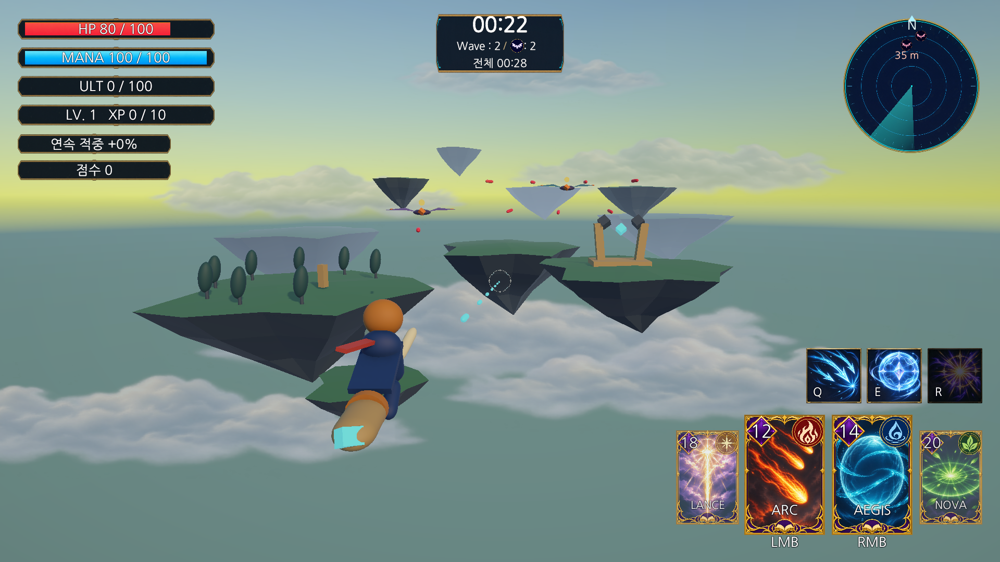

---
# 프로젝트 G

하늘섬 사이를 마법 빗자루로 비행하는 PC용 3D 공중 탄막 슈팅 프로젝트입니다.

---
## 3D 하늘섬 외곽 항로

Windows 빌드는 `Assets/Scenes/OuterIslandsStage.unity`에서 시작합니다. Unity **6000.3.21f1**에서 이 씬을 열고 Play를 눌러 같은 항로를 시작할 수 있습니다. `FlightVolume`, `SpawnPoints`, `EnemyEncounter`, `CloudLayers`에서 비행 체적·적 경로·출현 시각·구름 배치를 편집합니다. 개별 조작과 탄막은 `Assets/Scenes/FlightPrototype.unity`에서 시험합니다.

| 입력 | 동작 |
|---|---|
| WASD | 전후·좌우 비행 |
| Space | 상승 |
| Ctrl | 하강 |
| Shift | 집중 비행 |
| 마우스 이동 | 비행 방향과 화면 중앙 조준 조작 |
| 자동 | 기본 마법탄 사격 |
| 좌클릭 / 우클릭 | 왼쪽 / 오른쪽 현재 마법 카드 |
| Shift 유지 | 집중 마법탄 자동 사격 |
| 휠 버튼 유지 | 비행 방향을 유지하며 둘러보기 |
| F2 | 아리아와 리안의 시험 전투 설정 전환 |
| Q / E / R | 아리아 집중 포화 / 보호 / 유성 탄막 · 리안 관통 사격 / 1회 보호 / 천공 관측선 |
| T | 비행 시험 씬에서만 적탄 연습 켜기·끄기 |
| Y | 비행 시험 씬에서만 조준형·확산형·돌진형 수동 출현 |
| 1~4 | 비행 시험 씬에서만 조준·부채꼴·고리·나선 연습 탄막 선택 |
| Backspace | 시험 출격 재시작 |
| Esc | 일시정지. 계속하기에서 전투 복귀 |

Windows 시험 빌드에서 자동으로 시작한 두 번째 웨이브의 1920×1080 화면입니다. 상단 중앙의 큰 숫자는 전투 진행 시간입니다. `전체`는 정지 메뉴와 레벨업 선택 시간을 포함합니다. 오른쪽 위 레이더는 살아 있는 적의 방향과 거리를 보여 줍니다. 왼쪽 위에는 출격 점수와 최근 획득 숫자를 표시합니다.

[1024×576 하늘섬 외곽 전투](docs/screenshots/3d-day-16-hud-1024.png) · [획득 점수 연출](docs/screenshots/3d-day-15-flight.png) · [정지와 조작 안내](docs/screenshots/3d-day-14-pause.png) · [소리와 감도](docs/screenshots/3d-day-14-settings.png) · [강화 아이템](docs/screenshots/3d-day-14-enhancement.png)

[1일차 기록](docs/development/3d-day-01.md) · [2일차 기록](docs/development/3d-day-02.md) · [3일차 기록](docs/development/3d-day-03.md) · [4일차 기록](docs/development/3d-day-04.md) · [5일차 기록](docs/development/3d-day-05.md) · [6일차 기록](docs/development/3d-day-06.md) · [7일차 기록](docs/development/3d-day-07.md) · [8일차 기록](docs/development/3d-day-08.md) · [9일차 기록](docs/development/3d-day-09.md) · [10일차 기록](docs/development/3d-day-10.md) · [11일차 기록](docs/development/3d-day-11.md) · [12일차 기록](docs/development/3d-day-12.md) · [13일차 기록](docs/development/3d-day-13.md) · [14일차 기록](docs/development/3d-day-14.md) · [15일차 기록](docs/development/3d-day-15.md) · [16일차 기록](docs/development/3d-day-16.md)
