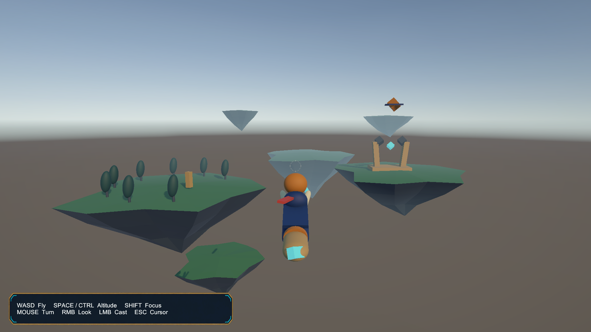

---
# 프로젝트 G

하늘섬 사이를 마법 빗자루로 비행하는 PC용 3D 공중 탄막 슈팅 프로젝트입니다.

---
## 3D 비행 시험

Unity **6000.3.21f1**에서 `Assets/Scenes/FlightPrototype.unity`를 열고 Play를 누릅니다. 이 씬은 Windows 빌드의 첫 씬이기도 합니다. 카메라, 아리아, 기본 빗자루, 하늘섬, 입력 안내는 Hierarchy에서 편집할 수 있습니다. 모델과 비행 속도는 시험용입니다.

| 입력 | 동작 |
|---|---|
| WASD | 전후·좌우 비행 |
| Space | 상승 |
| Ctrl | 하강 |
| Shift | 집중 비행 |
| 마우스 이동 | 비행 방향과 화면 중앙 조준 조작 |
| 좌클릭 | 기본 마법탄 사격 |
| Shift + 좌클릭 | 집중 마법탄 사격 |
| 우클릭 유지 | 비행 방향을 유지하며 둘러보기 |
| Esc | 마우스 해제. 게임 창에서 좌클릭으로 복귀 |

Windows 시험 빌드에서 자동 입력으로 비행한 뒤 마법탄을 발사한 시점의 1920×1080 화면입니다. [1일차 기록](docs/development/3d-day-01.md) · [2일차 기록](docs/development/3d-day-02.md) · [3일차 기록](docs/development/3d-day-03.md)
