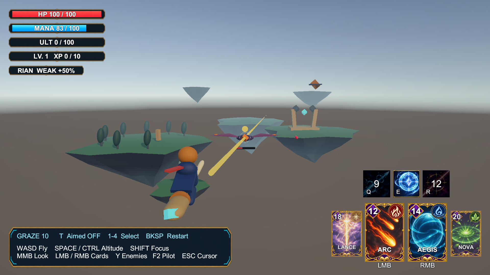

---
# 프로젝트 G

하늘섬 사이를 마법 빗자루로 비행하는 PC용 3D 공중 탄막 슈팅 프로젝트입니다.

---
## 3D 비행 시험

Unity **6000.3.21f1**에서 `Assets/Scenes/FlightPrototype.unity`를 열고 Play를 누릅니다. 이 씬은 Windows 빌드의 첫 씬이기도 합니다. 카메라, 시험 비행체, 기본 빗자루, 하늘섬, 입력 안내는 Hierarchy에서 편집할 수 있습니다. 모델과 비행 속도는 시험용입니다.

| 입력 | 동작 |
|---|---|
| WASD | 전후·좌우 비행 |
| Space | 상승 |
| Ctrl | 하강 |
| Shift | 집중 비행 |
| 마우스 이동 | 비행 방향과 화면 중앙 조준 조작 |
| 자동 | 기본 마법탄 사격 |
| 좌클릭 / 우클릭 | 왼쪽 / 오른쪽 현재 마법 카드 |
| Shift 유지 | 집중 마법탄 자동 사격 |
| 휠 버튼 유지 | 비행 방향을 유지하며 둘러보기 |
| F2 | 아리아와 리안의 시험 전투 설정 전환 |
| Q / E / R | 아리아 집중 포화 / 보호 / 유성 탄막 · 리안 관통 사격 / 1회 보호 / 천공 관측선 |
| T | 적탄 연습 켜기·끄기 |
| Y | 조준형·확산형·돌진형의 이동 및 공격 시험 |
| 1~4 | 조준·부채꼴·고리·나선 탄막 선택 |
| Backspace | 시험 출격 재시작 |
| Esc | 마우스 해제. 게임 창에서 좌클릭으로 복귀 |

Windows 시험 빌드에서 리안의 전용 스킬과 천공 관측선을 확인한 1920×1080 화면입니다. 일반·집중 비행 최고 속도는 초당 12·6 유닛입니다. [1일차 기록](docs/development/3d-day-01.md) · [2일차 기록](docs/development/3d-day-02.md) · [3일차 기록](docs/development/3d-day-03.md) · [4일차 기록](docs/development/3d-day-04.md) · [5일차 기록](docs/development/3d-day-05.md) · [6일차 기록](docs/development/3d-day-06.md) · [7일차 기록](docs/development/3d-day-07.md) · [8일차 기록](docs/development/3d-day-08.md) · [9일차 기록](docs/development/3d-day-09.md) · [10일차 기록](docs/development/3d-day-10.md) · [11일차 기록](docs/development/3d-day-11.md)

[1100×620 Windows 게임 화면](docs/screenshots/3d-day-11-hud-1100.png)
