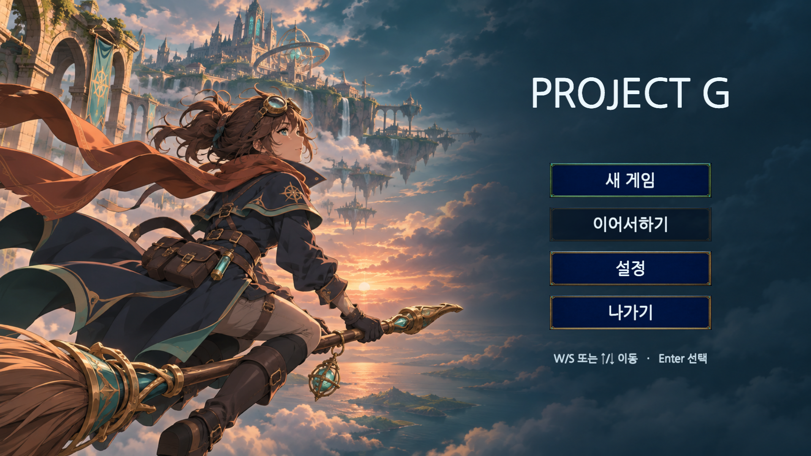
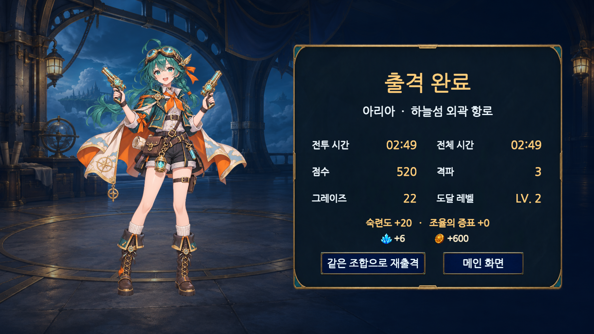

---
# 프로젝트 G

하늘섬 사이를 마법 빗자루로 비행하는 PC용 3D 공중 탄막 슈팅 프로젝트입니다.

47일차에는 현재 마법 덱·저장 형식과 이전 시험 번들을 비교했다. 기존 구현과 48일차 이식 범위는 [47일차 기록](docs/development/3d-day-47.md)에 정리했다.

UI의 작은 굵은 글자와 화면 픽셀 정렬을 조정했다. 확인한 화면과 아직 확인하지 못한 해상도는 [UI 선명도 수정 기록](docs/development/ui-clarity-followup.md)에 정리했다.

장비 상점과 강화 공방의 캐릭터 선택에는 투명 초상화와 캐릭터별 단색 배경을 사용한다. 이름과 초상화, 배경색은 마을 씬에서 각각 편집할 수 있다.

---
## 메인 화면

Windows 빌드는 `Assets/Scenes/FlightMainMenu.unity`에서 시작합니다. 새 게임과 이어서하기는 하늘섬 마을 착륙장으로 이어집니다. 이어서하기는 마지막 조종사와 저장된 장비·마법을 불러옵니다. 설정에서 화면 모드·해상도·음량·마우스 감도를 적용할 수 있습니다. [설정 화면](docs/screenshots/3d-day-39-master-volume.png) · [1024×576 시작 화면](docs/screenshots/3d-day-23-title-1024.png) · [23일차 기록](docs/development/3d-day-23.md)

---
## 하늘섬 마을

착륙장에서 이동 키로 광장을 지나 북쪽 다리를 건넙니다. 출격소에 접근하면 **E** 또는 출격 준비 버튼으로 캐릭터와 장비를 선택할 수 있습니다. 준비에서 뒤로가기를 누르면 출격소 앞으로 돌아갑니다. 마을에서 Esc는 메인 화면으로 돌아갑니다. [착륙장](docs/screenshots/3d-day-29-landing.png) · [장비 상점](docs/screenshots/3d-day-29-market.png) · [강화 공방](docs/screenshots/3d-day-29-workshop.png) · [1024×576 출격소](docs/screenshots/3d-day-29-sortie-1024.png) · [29일차 기록](docs/development/3d-day-29.md)

상점 주인, 공방 담당자, 출격 안내원에게 가까이 가서 **F**를 누르면 대화가 열립니다. F로 대사를 펼치거나 다음 문장으로 넘어갑니다. 선택지는 **1–3**, 방향키와 Enter, 마우스로 고릅니다. 이용 방법을 묻거나 기존 상점·공방·출격 준비를 열 수 있습니다. [상점 주인 대화](docs/screenshots/3d-day-41-market-dialogue.png) · [공방 담당자](docs/screenshots/3d-day-41-forge-dialogue.png) · [41일차 기록](docs/development/3d-day-41.md)

서쪽 장비 상점에서는 골드로 빗자루 부품을 사고 장착하거나 캐릭터별 E 스킬을 보호막·산탄으로 바꿀 수 있습니다. 동쪽 강화 공방에서는 장착 부품에 천공 결정과 골드를 사용해 최대 +5까지 강화합니다. 두 시설은 가까이에서 E로 열고 Esc로 닫습니다. [상점 UI](docs/screenshots/3d-day-30-market.png) · [공방 UI](docs/screenshots/3d-day-30-forge.png) · [1024×576 재실행 확인](docs/screenshots/3d-day-30-forge-1024.png) · [30일차 기록](docs/development/3d-day-30.md)

강화 공방의 **후속 성장**에서 조종사별 첫 과제와 카드 해금을 확인합니다. 최초 과제 정산으로 해당 조종사의 조율의 증표를 한 번 받고, 천공 결정 18개와 증표 1개로 노드를 해금합니다. 해금한 2단계 카드는 출격 중 같은 분기 1단계를 골라야 후보에 들어갑니다. [아리아 첫 과제](docs/screenshots/3d-day-31-aria-task.png) · [리안 첫 과제](docs/screenshots/3d-day-31-rian-task.png) · [1024×576 후속 성장 복원](docs/screenshots/3d-day-31-restore-growth.png) · [31일차 기록](docs/development/3d-day-31.md)

---
## 캐릭터 선택과 출격 준비

`Assets/Scenes/FlightSortieBriefing.unity`에서 아리아·리안·루미·세라·녹스·베라·이리스를 선택하고, 빗자루 조립과 마법 편성을 조정합니다. 오른쪽 아래 출발 버튼으로 선택한 조합이 실제 항로에 반영됩니다. [아리아 준비 화면](docs/screenshots/3d-day-24-aria.png) · [1024×576 준비 화면](docs/screenshots/3d-day-24-briefing-1024.png) · [24일차 기록](docs/development/3d-day-24.md)

루미는 같은 적을 추적할수록 유도탄 회전력이 높아집니다. Q는 별빛 추적탄, R은 서로 다른 고도의 적에게 분산되는 별무리 항로를 발사합니다. 천공 결정은 파란 결정 다발 아이콘, 골드는 금빛 동전 아이콘으로 상점·강화·출격과 정산의 수치에 표시합니다. [루미 준비 화면](docs/screenshots/3d-day-32-lumi-briefing.png) · [전투](docs/screenshots/3d-day-32-lumi-combat.png) · [상점](docs/screenshots/3d-day-32-market.png) · [결과](docs/screenshots/3d-day-32-result.png) · [32일차 기록](docs/development/3d-day-32.md)

출격 준비와 정산에서 **첫 사건 기록** 또는 F3으로 균열 조사와 아리아·리안의 첫 만남을 읽을 수 있습니다. 실전에서는 F3으로 현재 작전 통신만 닫습니다. [첫 사건 기록](docs/screenshots/3d-day-40-archive.png) · [조우 통신](docs/screenshots/3d-day-40-midboss.png) · [40일차 기록](docs/development/3d-day-40.md)

출격 준비에서 **자유 훈련** 또는 F4를 누르면 선택한 조종사로 자유 비행, 표적 사격, 마물 경로와 네 가지 탄막을 연습합니다. 설정에서 한 번 또는 반복을 고르고 같은 연습을 초기화할 수 있습니다. 경험치·강화 아이템·영구 보상 지급은 본편에서 진행합니다. [자유 훈련 메뉴](docs/screenshots/3d-day-41-training.png) · [고리 탄막 훈련](docs/screenshots/3d-day-41-ring.png)

출격 준비에서 **보스 러시** 또는 F5를 누르면 현재 조종사와 장비로 중간·최종 보스를 연속으로 상대합니다. 중간 보스 격파 후 체력·마력을 회복하며 클리어 시간은 조종사별로 기록합니다. [보스 러시 진입](docs/screenshots/3d-day-42-briefing.png) · [최종 보스](docs/screenshots/3d-day-42-final-boss.png) · [보스 러시 결과](docs/screenshots/3d-day-42-result.png) · [42일차 기록](docs/development/3d-day-42.md)

출격 준비에서 **탐험** 또는 F6을 누르면 교전·우회 보급을 고르고, 임시 상점에서 자동탄을 강화할 수 있습니다. 지도에서 닫은 뒤 F6을 다시 누르면 같은 조종사와 지점을 복원합니다. 탐험을 끝내면 보급표와 임시 강화가 초기화됩니다. [탐험 지도](docs/screenshots/3d-day-43-map.png) · [임시 상점](docs/screenshots/3d-day-43-merchant.png) · [중단 복원](docs/screenshots/3d-day-43-restore.png) · [43일차 기록](docs/development/3d-day-43.md)

출격 준비에서 **첫 비행 안내** 또는 F1을 누르면 이동·집중·자동 사격·그레이즈·스킬을 연습합니다. Enter로 출격 준비에 돌아갈 수 있고, Tab으로 마우스 포인터를 전환해 안내 버튼을 클릭할 수 있습니다. [1024×576 첫 비행 안내](docs/screenshots/3d-day-27-guide-1024.png) · [4:3 출격 준비](docs/screenshots/3d-day-27-briefing-4x3.png) · [27일차 기록](docs/development/3d-day-27.md)

---
## 출격 결과와 재출격

최종 보스를 격파하거나 체력을 모두 잃으면 결과 확인 버튼이 켜지고 결과에 맞는 음악이 한 번 재생됩니다. 결과 화면은 전투·전체 시간, 점수, 격파 수, 그레이즈, 도달 레벨을 표시합니다. 같은 캐릭터와 저장한 장비·마법으로 다시 출격하거나 메인 화면으로 돌아갈 수 있습니다. [1024×576 실패 결과](docs/screenshots/3d-day-25-failed-1024.png) · [25일차 기록](docs/development/3d-day-25.md)

결과 화면 왼쪽에는 출격한 조종사의 전신 일러스트, 오른쪽에는 전투 기록·보상·다시 출격 버튼을 표시합니다. 세라는 근거리 적에게 더 큰 피해를 주며, Q 돌파 검기와 R 천공 연참으로 전방을 공격합니다. [세라 결과](docs/screenshots/3d-day-33-sera-result.png) · [루미 결과 1024×768](docs/screenshots/3d-day-33-lumi-result-4x3.png) · [세라 전투](docs/screenshots/3d-day-33-sera-blade.png) · [33일차 기록](docs/development/3d-day-33.md)

녹스는 그레이즈로 반격 표식을 모읍니다. Q는 표식 하나당 반격탄 한 발을 발사하고, R은 반경 3m 안의 일반 적탄을 지웁니다. [표식 HUD](docs/screenshots/3d-day-34-nox-marks.png) · [경계 역전](docs/screenshots/3d-day-34-nox-reversal.png) · [34일차 기록](docs/development/3d-day-34.md)

베라는 Q로 상단 프로펠러가 달린 부유 포대 한 기를 배치하며, 포대에서 R 교차 광선을 발사합니다. 포대가 만료되면 R이 잠기고 에너지는 보존됩니다. [부유 포대](docs/screenshots/3d-day-35-vera-turret.png) · [교차 광선](docs/screenshots/3d-day-35-vera-beam.png) · [35일차 기록](docs/development/3d-day-35.md)

이리스는 서로 다른 적을 맞히면 파동 범위가 넓어집니다. Q 확산 파동은 전방의 적을 공격하고, R 창공의 공명은 직접 적중한 곳에서 다른 적에게 최대 두 번 이어집니다. [일곱 조종사 선택](docs/screenshots/3d-day-36-iris-briefing.png) · [이리스 전투](docs/screenshots/3d-day-36-iris-chain.png) · [36일차 기록](docs/development/3d-day-36.md)

캐릭터별 빗자루 부품의 피해 감소, 최대 마력, 초당 마력 회복이 전투에 반영됩니다. 리안의 약점 보너스는 강화 후 실제 피해에 적용되는 수치를 표시합니다. [최종 보스 3페이즈](docs/screenshots/3d-day-37-aria-final-boss.png) · [37일차 통합 검증 기록](docs/development/3d-day-37.md)

첫 웨이브가 시작된 출격은 영구 정산에 포함됩니다. 결과에서 숙련도와 재료 증가량을, 출격 준비에서 누적 숙련도와 보유량을 확인할 수 있습니다. 전투 도중 종료한 출격은 다음 실행의 메인 화면에서 참여 보상으로 한 번 정산됩니다. [영구 정산 화면](docs/screenshots/3d-day-26-settlement.png) · [재실행 복구 화면](docs/screenshots/3d-day-26-recovery-1024.png) · [26일차 기록](docs/development/3d-day-26.md)

---
## 3D 하늘섬 외곽 항로

적탄 풀은 실제 활성 탄만 갱신하고 비활성 탄을 다시 사용합니다. 128발을 유지한 Windows 비교에서 3회 중앙 프레임 시간이 0.820ms에서 0.714ms로 바뀌었습니다. [측정 조건과 결과](docs/development/3d-day-45.md)

Steam용 도전 조건의 로컬 저장과 모의 어댑터 재시도는 검증했습니다. 실제 Steam App ID, 도전 과제 등록, Steam Cloud는 연동 대기 상태입니다. [44일차 연동 기록](docs/development/3d-day-44.md)

[46일차 Windows 배포 후보 검증](docs/development/3d-day-46.md) · [메인 화면](docs/screenshots/3d-day-46-title.png) · [중단 출격 복구 화면](docs/screenshots/3d-day-46-recovered.png) · [출격 안내원 대화](docs/screenshots/3d-day-46-village-sortie-dialogue.png) · [리안 결과 화면](docs/screenshots/3d-day-46-result.png)

Unity **6000.3.21f1**에서 `Assets/Scenes/OuterIslandsStage.unity`를 열면 항로에 직접 출격할 수 있습니다. `FlightVolume`, `SpawnPoints`, `EnemyEncounter`, `CloudLayers`에서 비행 체적·적 경로·출현 시각·구름 배치를 편집합니다. 개별 조작과 탄막은 `Assets/Scenes/FlightPrototype.unity`에서 시험합니다.

일곱 조종사의 저폴리곤 비행 모형은 `AriaPilot/PilotModels`에서 편집합니다. 좌우 이동과 상승·하강 속도에 맞춰 조종사와 빗자루 외형이 함께 기울고, 조준과 발사 위치는 유지됩니다. 옷자락이 움직이고, 조종사는 화면 중앙의 조준점 왼쪽 아래에 있습니다. 적탄은 주황 조준 구체, 금빛 부채꼴 사각탄, 분홍 고리 결정, 붉은 나선 결정으로 구분합니다. [네 탄막 비교](docs/screenshots/3d-day-38-bullet-shapes.png) · [1024×576 탄막](docs/screenshots/3d-day-38-bullet-shapes-1024.png) · [일반 마물 실루엣](docs/screenshots/3d-day-38-enemy-shapes.png) · [38일차 기록](docs/development/3d-day-38.md)

타이틀 설정은 16:9 창과 1280×800, 1024×768을 지원합니다. [소형 16:9 전투](docs/screenshots/3d-day-27-hud-1024.png) · [16:10 전투](docs/screenshots/3d-day-27-hud-16x10.png) · [4:3 전투](docs/screenshots/3d-day-27-hud-4x3.png)

| 입력 | 동작 |
|---|---|
| WASD | 전후·좌우 비행 |
| Space | 상승 |
| Ctrl | 하강 |
| Shift | 집중 비행 |
| 마우스 이동 | 비행 방향과 화면 중앙 조준 조작 |
| 자동 | 기본 마법탄 사격 |
| 좌클릭 / 우클릭 | 왼쪽 / 오른쪽 현재 마법 카드 |
| Shift 유지 | 집중 마법탄 자동 사격 |
| 휠 버튼 유지 | 비행 방향을 유지하며 둘러보기 |
| F2 | 훈련 씬 또는 첫 웨이브 시작 전 아리아와 리안 전환 |
| Q / E / R | 아리아 집중 포화 / 보호 / 유성 탄막 · 리안 관통 사격 / 1회 보호 / 천공 관측선 |
| T | 비행 시험 씬에서만 적탄 연습 켜기·끄기 |
| Y | 비행 시험 씬에서만 조준형·확산형·돌진형 수동 출현 |
| 1~4 | 비행 시험 씬에서만 조준·부채꼴·고리·나선 연습 탄막 선택 |
| Backspace | 시험 출격 재시작 |
| Esc | 일시정지. 계속하기에서 전투 복귀 |

타이틀·마을·외곽 항로에 각 배경곡이 있으며 중간·최종 보스 진입에는 보스곡으로 바뀝니다. Esc로 전투 음악과 효과음을 멈춰도 정지 메뉴 버튼음이 들립니다. 마스터 음량은 메인 설정과 전투 설정에서 조절할 수 있습니다. [전투 음량 설정](docs/screenshots/3d-day-39-paused-audio.png) · [39일차 기록](docs/development/3d-day-39.md) · [정식 음원 제작 브리프](https://docs.google.com/document/d/11SYgjADf-6TG3s7-TG01_Ue1nwgq3DP6-zUa63HLyig/edit?tab=t.p64gk563fhsh)

출격 준비의 `마법 제작`에서 해금한 구성을 저장하고 최대 두 칸에 편성합니다. 빈 칸과 같은 마법의 중복 장착을 허용하며 출격마다 좌우를 무작위로 배정합니다. 전투가 시작된 뒤에는 제작·편성 변경을 차단합니다. 편성 한도가 줄면 낮은 유지 우선순위부터 자동 해제하고 한도가 돌아오면 가능한 원래 슬롯을 복구합니다. [56일차 기록](docs/development/3d-day-56.md) · [48일차 기록](docs/development/3d-day-48.md)

제작 화면과 마을 공방의 `연구 · 보상`에서 아홉 분류의 진행률·선행 조건을 확인하고 연구·상점·보상 선택을 확정합니다. 정상 출격의 무료 연구 선택권은 받을 수 있을 때까지 보류됩니다. 잠기거나 미지원인 기존 마법은 저장을 보존하고 실제 전투 카드에서는 제외합니다. [55일차 기록](docs/development/3d-day-55.md)

`마법 도감`에서 저장한 마법을 검색·복제·이름 변경하고 참조하지 않는 항목을 확인 후 삭제합니다. `비행 미리보기`는 편집 중인 조합과 현재 조종사·빗자루로 독립 표적을 시험하며, 중앙 화면 클릭으로 비행하고 `Tab`으로 같은 연습을 전체 화면으로 전환합니다. `Esc`는 비행 입력을 편집 화면으로 돌립니다. 표준·고속·장거리 성능은 확정된 이동형 마법에만 적용합니다. [오프스크린 비행 화면](docs/screenshots/3d-day-56-preview-offscreen.png) · [연구 화면](docs/screenshots/3d-day-56-research-offscreen.png)

56일차는 부분 구현입니다. 구성 요소의 아이콘 선택 화면과 연출 강도 설정, 기획서의 전체 연습 표적·경계, 도감의 프리셋 참조 및 지정 해상도의 실제 화면 검증은 남아 있습니다. [남은 항목](docs/development/3d-day-56.md)

동일 조종사의 숙련도와 정상 정산 과제로 계정 공용 연구 자격을 계산하고, 구성 요소별 선행 연구와 해금을 영구 저장합니다. [54일차 기록](docs/development/3d-day-54.md)

확정된 제작 마법 15종의 전투 판정을 연결했습니다. 루미너스 레이는 버튼을 유지하는 동안 조준 방향으로 발사하고, 다크 오비트는 흡수가 허용된 적탄에서만 마력을 회복합니다. [53일차 기록](docs/development/3d-day-53.md)

잿불 항로·덩굴 고리·씨앗 포대·황혼 파열의 경로, 속박, 지연 분열과 폭발을 적용했습니다. 설치체와 결계는 동시 3개 한도를 공유합니다. [52일차 기록](docs/development/3d-day-52.md)

플레임 스파이럴의 순차 발사와 화상, 급류 관통탄의 집중 발사, 회류 고리의 왕복 및 구간별 중복 피해 제한을 적용하고 홀리 샤워의 관통을 시험했습니다. [51일차 기록](docs/development/3d-day-51.md)

제작 마법의 실제 피해는 시전 시점의 마법 공격력을 기준값 100으로 나눈 배율을 적용합니다. 수치와 판정이 준비된 기획 마법만 실제로 시전하며, 미지원 조합의 기존 저장 ID는 보존합니다. 시전당 최초 24개·누적 96개와 플레이어 초당 40개·동시 128개의 생성 상한을 검사합니다. [50일차 기록](docs/development/3d-day-50.md)

제작 마법은 레벨업 선택에서 해당 마법에 실제로 적용되는 수치만 강화합니다. 같은 구성·성능 프리셋은 두 칸에서 쿨타임과 최대 `+3` 강화 이력을 공유하며, 일반 출격을 다시 시작하면 임시 강화가 초기화됩니다. 전투 카드는 구성 비용, 마력 비용, 강화 단계와 대기·마력 부족 상태를 표시하고 자동 해제된 카드는 숨깁니다. [49일차 기록](docs/development/3d-day-49.md)

`Esc → 빗자루 조립`에서는 현재 캐릭터의 8개 부위를 확인합니다. 후보를 고르면 3D 외형과 현재 조합에서 바뀌는 능력치가 표시되고, 장착 확정으로 저장한 조합은 재실행 후에도 복원됩니다. [조립 화면](docs/screenshots/3d-day-20-workshop.png) · [1024×576 재실행 화면](docs/screenshots/3d-day-20-reload-1024.png) · [20일차 기록](docs/development/3d-day-20.md)

빗자루 카탈로그에는 기존 시작 부품 56종과 10개 세트의 부품 80종, 일반부터 전설까지의 5등급 기준 수치를 등록했습니다. 본편의 지정 처치로 얻은 부품은 결과와 개별 보유 기록을 함께 저장합니다. 마을 공방에서 획득한 종류의 해금된 등급을 제작하고 미장착·잠금 해제 부품을 분해할 수 있습니다. 60일차에 기본·조건부 수치, 일부 세트와 개별 특수 효과 및 조립 후보 넘김을 연결했습니다. 명중·대시 궤적 등 나머지 발동 효과, 충격 저항의 실제 충돌 적용과 정식 모델은 미완료입니다. [57일차 기록](docs/development/3d-day-57.md) · [58일차 기록](docs/development/3d-day-58.md) · [59일차 기록](docs/development/3d-day-59.md) · [60일차 기록](docs/development/3d-day-60.md) · [61일차 기록](docs/development/3d-day-61.md) · [62일차 기록](docs/development/3d-day-62.md) · [63일차 기록](docs/development/3d-day-63.md)

빗자루 조립의 부품 도감에서 10개 세트와 80개 부품의 그림·보유 여부·기획 효과를 확인합니다. [도감 화면](docs/screenshots/3d-day-63-gallery-1920.png)

출격 준비의 빗자루 조립에서 캐릭터별 프리셋을 최대 5개 저장하고, 적용 가능 필터·능력치 비교·복제·이름 변경·삭제를 사용할 수 있습니다. 부품이나 마법 사본이 없거나 충돌·한도 부족이 있으면 전체 적용을 취소합니다. 기본 부품은 일괄 미리보기 후 확정하거나 취소할 수 있습니다. [프리셋 화면](docs/screenshots/3d-day-62-presets-1920.png)

제작 마법의 정수 구성 비용은 실제 소수 마법 공격력을 넘을 수 없습니다. 장비와 집중 효과로 한도가 변하면 우선순위에 따라 자동 해제·복구하며 저장 구성·전투 강화·남은 쿨타임을 보존합니다.

마을 상점·공방과 출격 준비의 보유 재화는 오른쪽 위에 표시합니다. 이후 UI를 추가하거나 수정할 때도 글자 잘림·크기, 이미지 원본 해상도와 축소 필터, 다른 요소와의 겹침을 확인합니다. 실제 모니터와 다양한 해상도의 수동 검증은 별도로 남아 있습니다. [공방 화면 밖 렌더](docs/screenshots/3d-day-59-forge-offscreen.png) · [상점 화면 밖 렌더](docs/screenshots/3d-day-59-market-offscreen.png)

제작 마법의 구성 ID와 고정 비용, 호환성·탄수 제한, 직선·확산·유도 방향은 편집기와 전투에서 공유합니다. [21일차 제작 마법 규칙](docs/development/3d-day-21.md)

질풍의 몸체를 장착하면 아리아의 수평 최고 속도가 12.3 m/s에서 12.7 m/s로 바뀝니다. Unity의 `AriaPilot/TrainingBroom/PartMounts`에서 부품 위치를 편집합니다. [기본 몸체](docs/screenshots/3d-day-19-default.png) · [질풍의 몸체](docs/screenshots/3d-day-19-flight.png) · [19일차 기록](docs/development/3d-day-19.md)

최종 보스전에서는 타이머 아래에 체력과 남은 페이즈가 표시됩니다. 노란 점은 현재 페이즈를 포함하고, 체력 1,000과 500에서 공격이 바뀌며 이전 탄막이 회수됩니다. `전체` 시간에는 일시정지와 레벨업 선택이 포함됩니다. [최종 보스 2페이즈](docs/screenshots/3d-day-18-flight.png) · [3페이즈 교차 나선](docs/screenshots/3d-day-18-crossing.png) · [1024×576 보스 HUD](docs/screenshots/3d-day-18-hud-1024.png) · [중간 보스전](docs/screenshots/3d-day-17-flight.png) · [바다와 해안](docs/screenshots/3d-day-17-surface.png) · [정지와 조작 안내](docs/screenshots/3d-day-14-pause.png)

아리아와 리안의 1080p 자동 플레이에서 두 캐릭터의 장비·마법 편성, 성장, 최종 보스, 영구 정산과 재출격을 확인했습니다. 프레임 시간의 측정 조건과 미검증 항목은 28일차 기록에 정리했습니다. [아리아 클리어](docs/screenshots/3d-day-28-aria-result.png) · [리안 보스전](docs/screenshots/3d-day-28-rian-boss.png) · [리안 실패](docs/screenshots/3d-day-28-rian-result.png) · [재실행 복구](docs/screenshots/3d-day-28-recovery.png) · [28일차 기록](docs/development/3d-day-28.md)

[1일차 기록](docs/development/3d-day-01.md) · [2일차 기록](docs/development/3d-day-02.md) · [3일차 기록](docs/development/3d-day-03.md) · [4일차 기록](docs/development/3d-day-04.md) · [5일차 기록](docs/development/3d-day-05.md) · [6일차 기록](docs/development/3d-day-06.md) · [7일차 기록](docs/development/3d-day-07.md) · [8일차 기록](docs/development/3d-day-08.md) · [9일차 기록](docs/development/3d-day-09.md) · [10일차 기록](docs/development/3d-day-10.md) · [11일차 기록](docs/development/3d-day-11.md) · [12일차 기록](docs/development/3d-day-12.md) · [13일차 기록](docs/development/3d-day-13.md) · [14일차 기록](docs/development/3d-day-14.md) · [15일차 기록](docs/development/3d-day-15.md) · [16일차 기록](docs/development/3d-day-16.md) · [17일차 기록](docs/development/3d-day-17.md) · [18일차 기록](docs/development/3d-day-18.md)
