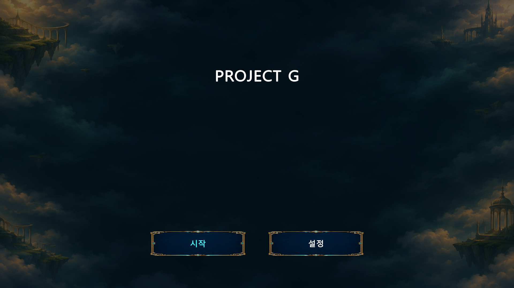
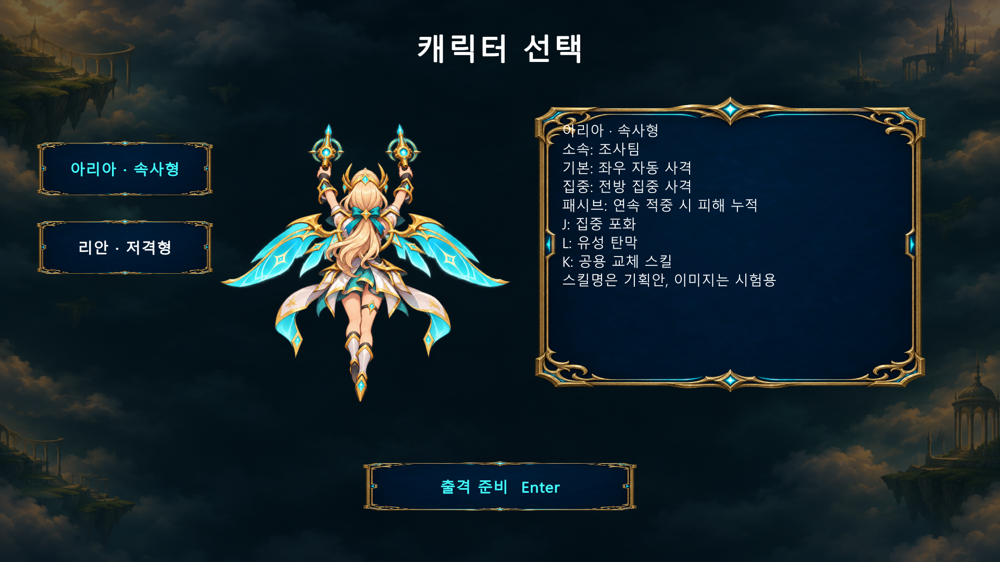
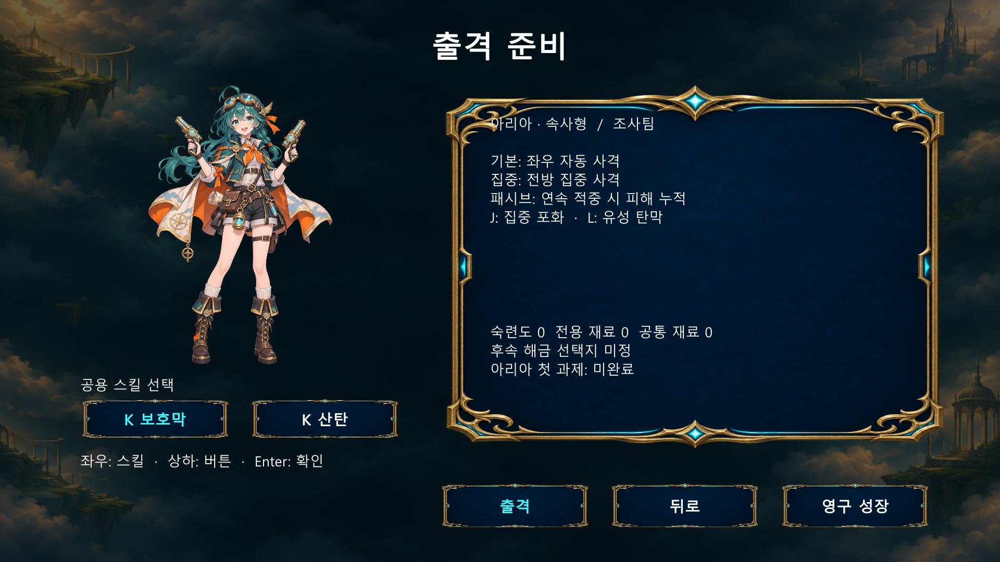
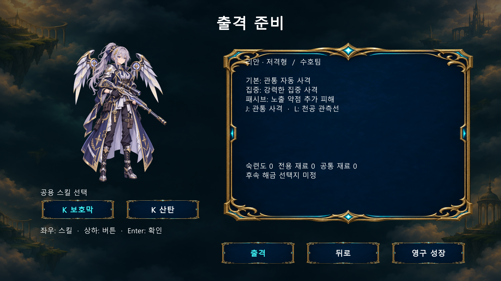
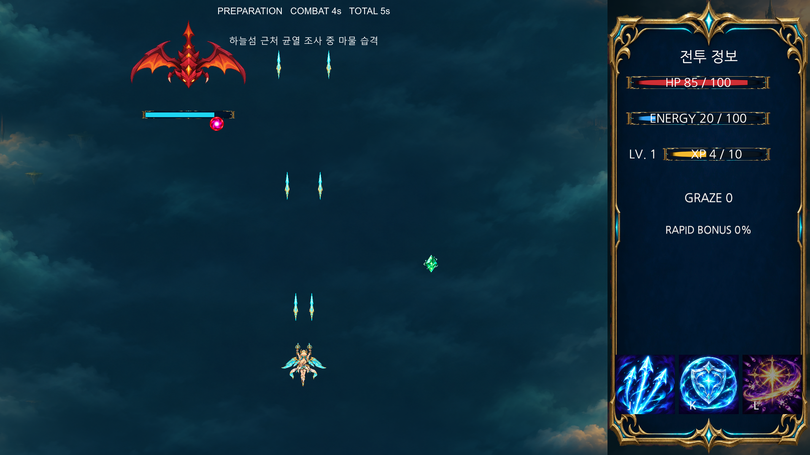

---
# 프로젝트 G

프로젝트 G는 하늘섬을 무대로 하는 PC 우선 2D 종스크롤 탄막 액션 슈팅 게임입니다. 현재 Unity 6000.3.21f1에서 전투와 메뉴를 시험 개발하고 있습니다.

---
## 실제 게임 화면

아래 이미지는 별도 시험 환경에서 실행한 Unity 게임 화면을 그대로 캡처한 것입니다. 화면을 자동으로 전환했고, 전투 장면에서는 게이지와 적 체력 표시를 확인하기 위해 체력·에너지·경험치 시험값과 적 피격을 적용했습니다. 이미지와 수치에는 시험용 시안이 포함되어 있습니다.

---
### 타이틀

시작과 설정 화면으로 이동합니다.

---
### 캐릭터 선택

속사형 아리아와 저격형 리안의 전투 방식과 스킬을 살펴보고 출격할 캐릭터를 선택합니다.

---
### 출격 준비

공용 K 스킬을 선택하고 캐릭터별 전신 이미지와 보유 성장 정보를 확인한 뒤 출격합니다. 정보가 길어지면 Page Up / Page Down으로 이동할 수 있습니다.

---
### 전투

왼쪽 전투 영역에서 이동과 공격을 수행하고, 오른쪽 정보 패널에서 체력·에너지·레벨·경험치와 그레이즈를 확인합니다. 패널 아래의 세 칸은 J 고유 스킬, K 공용 스킬, L 필살기이며 전투 영역 위쪽에는 진행 정보가 표시됩니다. 적의 체력 표시는 피해를 받은 뒤 잠시 나타납니다.

---
## 기본 조작

- **WASD:** 이동
- **Shift:** 집중 이동과 집중 공격
- **J:** 고유 스킬
- **K:** 공용 스킬
- **L:** 필살기

기본 공격은 자동으로 발사됩니다. 키와 화면 설정은 게임의 설정 화면에서 조정할 수 있습니다.

---
## 개발 기록

일차별 작업과 검증 결과는 [개발 기록](docs/development/)에서 확인할 수 있습니다. UI나 화면 구성에 시각적 변경이 생기면 해당 스크린샷과 설명도 함께 갱신합니다.
